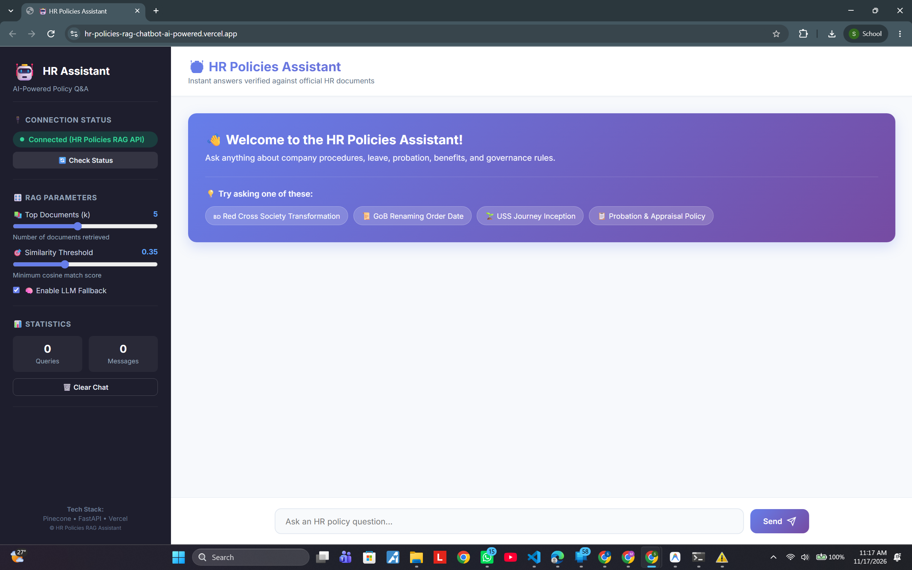
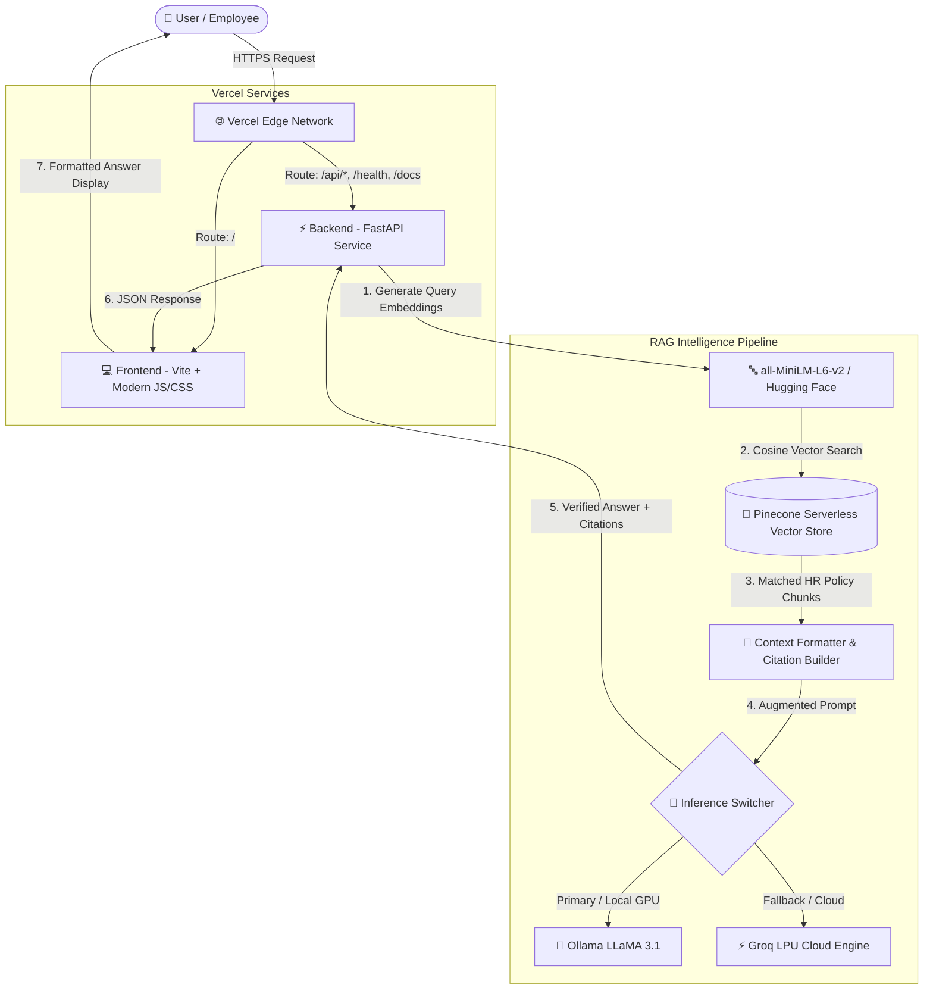

# 🤖 HR Policies RAG Chatbot — AI-Powered Document Q&A

A modern, production-grade **Retrieval-Augmented Generation (RAG)** assistant designed for corporate HR policy intelligence and automated document question answering. Built with **FastAPI**, **Vite**, **Pinecone Vector Database**, **Ollama LLaMA 3.1**, and **Groq Cloud Inference**.

[](https://hr-policies-rag-chatbot-ai-powered.vercel.app/)
[](https://vercel.com/shah-abdul-mazids-projects/hr-policies-rag-chatbot-ai-powered-document-q-a/46CbuPqQqFXLsMggmBwkv7RGNXNV)
[](https://www.shahabdulmazidezan.me/)
[](https://github.com/Shah-Abdul-Mazid/HR-Policies-RAG-Chatbot-AI-Powered-Document-Q-A)


---



---

## 🌟 Key Highlights

- 📚 **Grounded Document Verification (Zero Hallucinations):** Strict policy-bound retrieval guarantees responses are extracted directly from verified enterprise HR manuals (`HRMD Procedures`, `Human Resources Policy & Manual`, `USS HRD Policy`).
- ⚡ **Hybrid Dual-Engine Inference:** Supports local GPU execution via **Ollama (LLaMA 3.1 8B)** with tunnel bridging as well as ultra-low latency **Groq Cloud LPU** inference for serverless environments.
- 🎯 **Semantic Vector Search:** High-dimensional dense embeddings (`all-MiniLM-L6-v2`) indexed in **Pinecone Serverless** for sub-second similarity matching.
- 🎛️ **Live Parameter Tuning:** Interactive sidebar controls allow users to adjust top-$k$ document chunk retrieval, similarity thresholds, and fallback flags in real time.
- 🚀 **Vercel Multi-Service Micro-Architecture:** Unified repository deployment serving both a **Vite single-page application** and a **FastAPI backend** through unified edge rewrites.
- 🩺 **Dynamic Health & Status Telemetry:** Integrated health check protocol (`/health` and `/api/health`) that tests backend readiness, database latency, and service connectivity.
- 📑 **Audit-Ready Source Citations:** Every generated response includes exact document references, page numbers, and similarity confidence scores.

---

## 🏗️ System Architecture



---

## 📁 Repository Structure

```text
HR-Policies-RAG-Chatbot-AI-Powered-Document-Q-A/
├── Backend/                            # FastAPI Backend Service
│   ├── app/
│   │   ├── ai/
│   │   │   ├── llm.py                  # Dual LLM engine (Ollama + Groq)
│   │   │   ├── rag.py                  # Pinecone retrieval & prompt synthesis
│   │   │   └── vector_store.py         # Vector index connection & embeddings
│   │   ├── core/
│   │   │   └── config.py               # Pydantic v2 settings & environment loader
│   │   ├── api/
│   │   │   └── endpoints.py            # API routes (/ask, /health, /status)
│   │   └── main.py                     # Inner FastAPI application
│   ├── main.py                         # Root Vercel FastAPI entrypoint
│   ├── pyproject.toml                  # Python package configuration
│   └── requirements.txt                # Production backend dependencies
│
├── Frontend/                           # Modern Chat Interface (Vite)
│   ├── src/
│   │   ├── main.js                     # Health check, streaming chat, and state
│   │   └── style.css                   # Glassmorphic responsive dark theme
│   ├── index.html                      # Single page application markup
│   ├── package.json                    # Frontend dependencies & Vite scripts
│   └── vite.config.js                  # Vite configuration & dev proxy
│
├── HR Policies/                        # Authentic HR policy documents (PDFs)
│   ├── HRMD-Procedures.pdf
│   ├── Human Resources policy and manual.pdf
│   └── USS HRD Policy Revised 2016.pdf
│
├── vercel.json                         # Vercel Multi-Service configuration
├── pyproject.toml                      # Workspace Python definitions
└── README.md                           # Project documentation
```

---

## 🚀 Live Endpoints

| Endpoint | Method | Description |
|---|---|---|
| `https://hr-policies-rag-chatbot-ai-powered.vercel.app/` | `GET` | Main Web Application UI |
| `https://hr-policies-rag-chatbot-ai-powered.vercel.app/health` | `GET` | Health Check (`{"status": "online", "service": "HR Policies RAG API"}`) |
| `https://hr-policies-rag-chatbot-ai-powered.vercel.app/docs` | `GET` | Interactive Swagger API Documentation |
| `https://hr-policies-rag-chatbot-ai-powered.vercel.app/api/ask` | `POST` | RAG Query Endpoint (accepts query, top_k, threshold) |
| `https://hr-policies-rag-chatbot-ai-powered.vercel.app/version` | `GET` | Current deployed service version and environment metadata |

---

## 🛠️ Local Development Setup

### 1. Prerequisites
- **Python 3.11+** installed
- **Node.js 18+** & npm installed
- *(Optional)* [Ollama](https://ollama.ai/) with `ollama pull llama3.1`

### 2. Clone the Repository
```bash
git clone https://github.com/Shah-Abdul-Mazid/HR-Policies-RAG-Chatbot-AI-Powered-Document-Q-A.git
cd HR-Policies-RAG-Chatbot-AI-Powered-Document-Q-A
```

### 3. Backend Setup
```bash
cd Backend
python -m venv .venv
# Windows:
.venv\Scripts\activate
# Linux/macOS:
source .venv/bin/activate

pip install -r requirements.txt
```

Create a `.env` file inside `Backend/`:
```env
PINECONE_API_KEY=your_pinecone_api_key_here
PINECONE_ENVIRONMENT=us-east-1
PINECONE_INDEX=hr-policies
PINECONE_NAMESPACE=hr-policies
GROQ_API_KEY=your_groq_api_key_here
OLLAMA_BASE_URL=http://127.0.0.1:11434
OLLAMA_MODEL=llama3.1:latest
```

Start the FastAPI development server:
```bash
uvicorn main:app --reload --port 8000
```
API Documentation will be live at `http://localhost:8000/docs`.

### 4. Frontend Setup
In a new terminal:
```bash
cd Frontend
npm install
npm run dev
```
Open `http://localhost:3000` or `http://localhost:5173` to interact with the assistant.

---

## 🌐 Production Deployment on Vercel

This repository is pre-configured with a modern **Vercel Multi-Service architecture** (`vercel.json`):

```json
{
  "$schema": "https://openapi.vercel.sh/vercel.json",
  "services": {
    "backend": {
      "root": "Backend",
      "framework": "fastapi",
      "entrypoint": "main:app",
      "installCommand": "pip install -r requirements.txt"
    },
    "frontend": {
      "root": "Frontend",
      "framework": "vite"
    }
  },
  "rewrites": [
    { "source": "/api/(.*)", "destination": { "service": "backend" } },
    { "source": "/api", "destination": { "service": "backend" } },
    { "source": "/docs(.*)", "destination": { "service": "backend" } },
    { "source": "/redoc(.*)", "destination": { "service": "backend" } },
    { "source": "/openapi.json(.*)", "destination": { "service": "backend" } },
    { "source": "/health", "destination": { "service": "backend" } },
    { "source": "/version", "destination": { "service": "backend" } },
    { "source": "/(.*)", "destination": { "service": "frontend" } }
  ]
}
```

### Required Vercel Environment Variables:
Navigate to **Vercel Dashboard > Project Settings > Environment Variables** and add:

| Variable | Description | Default / Example |
|---|---|---|
| `PINECONE_API_KEY` | Pinecone vector store API key | `pcsk_...` |
| `PINECONE_INDEX` | Target Pinecone vector index | `hr-policies` |
| `PINECONE_NAMESPACE` | Vector index namespace | `hr-policies` |
| `GROQ_API_KEY` | High-speed cloud LLM inference key | `gsk_...` |
| `GROQ_MODEL` | Default cloud model | `llama-3.1-8b-instant` |

---

## 👨‍💻 Author & Case Study

**Shah Abdul Mazid**  
*Full-Stack AI & Machine Learning Engineer*

- 🌐 **Portfolio & Case Studies:** [shahabdulmazidezan.me](https://www.shahabdulmazidezan.me/)
- 💻 **GitHub:** [@Shah-Abdul-Mazid](https://github.com/Shah-Abdul-Mazid)
- 🚀 **Live Project:** [hr-policies-rag-chatbot-ai-powered.vercel.app](https://hr-policies-rag-chatbot-ai-powered.vercel.app/)

---

## 📄 License

This project is open-source under the [MIT License](LICENSE).
